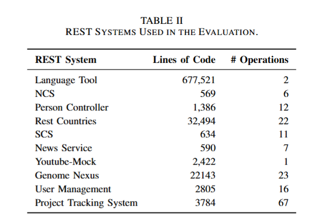

# Subject Services Setup

This document describes how to prepare the subject REST services used in our experiments.



## 1. Download Source Codes

### LanguageTool

```bash
git clone https://github.com/languagetool-org/languagetool.git
cd languagetool
git checkout 9525e1b9af4dc027fd52b8eb94e15ff2e70cc724
```

### Other Services
```
git clone https://github.com/selab-gatech/autoresttest
```

## 2. Build 
### (1) Before building the subject services, you need:
* Java configuration

The build requires **multiple Java environments**, including `JDK 8, JDK 11, and JDK 17`. Users should ensure that these JDKs are installed and that the corresponding environment-switching scripts `jdk.env` are correctly configured.

* Docker installed

### (1) SCS / NCS / REST Countries

```
source ./jdk.env 8
cd /path/to/autoresttest/aratrl-service/jdk8_1
mvn clean install -DskipTests && mvn dependency:build-classpath -Dmdep.outputFile=cp.txt
```

### (2) Person Controller / Genome Nexus / User Management

```
source ./jdk.env 8

cd /path/to/autoresttest/aratrl-service/jdk8_2/person-controller
mvn clean install -DskipTests && mvn dependency:build-classpath -Dmdep.outputFile=cp.txt

cd /path/to/autoresttest/aratrl-service/jdk8_2/genome-nexus
mvn clean install -DskipTests && mvn dependency:build-classpath -Dmdep.outputFile=cp.txt

cd /path/to/autoresttest/aratrl-service/jdk8_2/user-management
mvn clean install -DskipTests && mvn dependency:build-classpath -Dmdep.outputFile=cp.txt
```

### (3) Project Tracking System
```
source ./jdk.env 11

cd /path/to/autoresttest/aratrl-service/jdk11/project-tracking-system
mvn clean install -DskipTests && mvn dependency:build-classpath -Dmdep.outputFile=cp.txt
```

### (4) LanguageTool
```
source ./jdk.env 17

cd /path/to/languagetool
mvn clean install -DskipTests
```
### (5) Youtube-Mork

```
source ./jdk.env 8

cd /path/to/autoresttest/services/youtube
mvn clean install -DskipTests
```


## 2. Reset Service State
We provide the script `run_service_jacoco.py` to conveniently start and reset the services used in our experiments. Before using this script, please configure the local paths to hub `LanguageTool` and `AutoRestTest`.